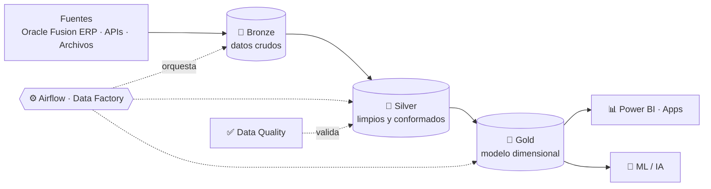

<!--
  Perfil de GitHub · Alejandro Parra Palacios
  Las tarjetas de /profile se generan con .github/workflows/readme-cards.yml (diario).
  La primera vez: pestaña Actions → "Actualizar tarjetas del perfil" → Run workflow.
-->

# ¡Hola! 👋 Soy Alejandro Parra Palacios

  
  
  

---

Data Engineer with experience designing and implementing scalable cloud data architectures using Azure, Databricks,
and Microsoft Fabric. Strong background in ETL/ELT development, medallion architecture (Bronze–Silver–Gold),
dimensional modeling, and Big Data processing with Python and PySpark. Experienced integrating enterprise data
from Oracle Fusion ERP, optimizing large-scale data pipelines, automating data quality processes, and enabling analytics
and machine learning workflows across distributed systems.

## 🧭 Sobre mí

- 💼 Actualmente **Senior AI & Data Engineer en EY (Ernst & Young)**.
- 🏭 Antes, **Data Engineer en Carvajal S.A.**, integrando datos empresariales desde Oracle Fusion ERP.
- 🎓 Posgrado en curso en el **Tecnológico de Monterrey** · Especialización en Analítica de Big Data (UAO) · Ingeniero Industrial (USC).
- 🌎 Basado en **Cali, Colombia** · Español nativo · Inglés profesional (B2).

## 🏗️ Cómo diseño pipelines

## 🔧 Tecnologías y Herramientas

| Área | Stack |
| :--- | :--- |
| **Lenguajes** | Python, Scala, SQL, PySpark, R, JavaScript, Java |
| **Cloud & Big Data** | Azure, Databricks, Microsoft Fabric, Snowflake, GCP (BigQuery, Cloud Run) |
| **Orquestación** | Apache Airflow, Azure Data Factory |
| **Data Engineering** | ETL/ELT, Medallion Architecture, Star Schema |
| **Visualización** | Power BI, Oracle OTBI |
| **Bases de Datos** | Oracle Fusion, SQL Server, PostgreSQL, MySQL, MongoDB |
| **DevOps & Otros** | Docker, Git, CI/CD, Linux |

  

## 🗺️ Trayectoria

| Periodo | Rol | Organización |
| :--- | :--- | :--- |
| Actual | Senior AI & Data Engineer | EY (Ernst & Young) |
| 06/2024 – 03/2026 | Data Engineer | Carvajal S.A. |
| 2026 – en curso | Posgrado | Tecnológico de Monterrey |
| 2024 – 2025 | Especialización en Analítica de Big Data | Universidad Autónoma de Occidente |
| 2018 – 2023 | Ingeniería Industrial | Universidad Santiago de Cali |

## 🌱 Actualmente Aprendiendo
- Aplicaciones avanzadas de Machine Learning e Inteligencia Artificial
- Integración de LLMs y agentes (MCP) sobre plataformas de datos
- Nuevas herramientas y técnicas de desarrollo de software

## 💪 Habilidades Clave
- **Mejora de Procesos**
- **Inglés Profesional (B2)**
- **Resolución de Problemas**
- **Mentalidad de Crecimiento**

## 📫 Cómo Contactarme

## 📈 Mis Estadísticas de GitHub

<picture>
  <source media="(prefers-color-scheme: dark)" srcset="./profile/stats-dark.svg" />
  
</picture>
<picture>
  <source media="(prefers-color-scheme: dark)" srcset="./profile/top-langs-dark.svg" />
  
</picture>

<picture>
  <source media="(prefers-color-scheme: dark)" srcset="https://streak-stats.demolab.com?user=AlejandroParraPalacios&theme=tokyonight&hide_border=true&locale=es" />
  
</picture>

---

¡Gracias por visitar mi perfil! Siéntete libre de explorar mis repositorios y proyectos. 
Siempre estoy abierto a colaborar en nuevas y emocionantes oportunidades.

