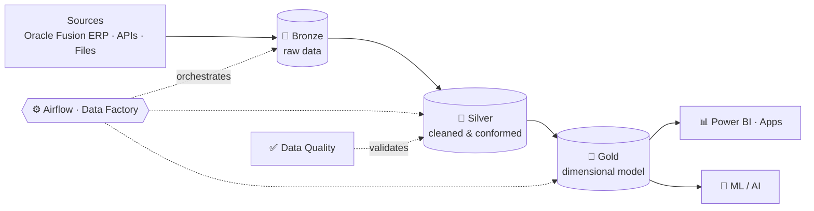

<!--
  GitHub Profile · Alejandro Parra Palacios
  Cards in /profile are generated daily by .github/workflows/readme-cards.yml.
  First time: Actions tab → "Actualizar tarjetas del perfil" → Run workflow.
-->

# Hi there! 👋 I'm Alejandro Parra Palacios

  
  
  

---

Data Engineer with experience designing and implementing scalable cloud data architectures using Azure, Databricks,
and Microsoft Fabric. Strong background in ETL/ELT development, medallion architecture (Bronze–Silver–Gold),
dimensional modeling, and Big Data processing with Python and PySpark. Experienced integrating enterprise data
from Oracle Fusion ERP, optimizing large-scale data pipelines, automating data quality processes, and enabling analytics
and machine learning workflows across distributed systems.

## 🧭 About Me

- 💼 Currently a **Senior AI & Data Engineer at EY (Ernst & Young)**.
- 🏭 Previously a **Data Engineer at Carvajal S.A.**, integrating enterprise data from Oracle Fusion ERP.
- 🎓 Graduate studies in progress at **Tecnológico de Monterrey** · Specialization in Big Data Analytics (UAO) · B.Sc. in Industrial Engineering (USC).
- 🌎 Based in **Cali, Colombia** · Native Spanish · Professional English (B2).

## 🏗️ How I Design Pipelines

## 🔧 Tech Stack & Tools

| Area | Stack |
| :--- | :--- |
| **Languages** | Python, Scala, SQL, PySpark, R, JavaScript, Java |
| **Cloud & Big Data** | Azure, Databricks, Microsoft Fabric, Snowflake, GCP (BigQuery, Cloud Run) |
| **Orchestration** | Apache Airflow, Azure Data Factory |
| **Data Engineering** | ETL/ELT, Medallion Architecture, Star Schema |
| **Visualization** | Power BI, Oracle OTBI |
| **Databases** | Oracle Fusion, SQL Server, PostgreSQL, MySQL, MongoDB |
| **DevOps & Other** | Docker, Git, CI/CD, Linux |

  

## 🗺️ Career Path

| Period | Role | Organization |
| :--- | :--- | :--- |
| Present | Senior AI & Data Engineer | EY (Ernst & Young) |
| 06/2024 – 03/2026 | Data Engineer | Carvajal S.A. |
| 2026 – Present | Graduate Studies | Tecnológico de Monterrey |
| 2024 – 2025 | Specialization in Big Data Analytics | Universidad Autónoma de Occidente |
| 2018 – 2023 | B.Sc. in Industrial Engineering | Universidad Santiago de Cali |

## 🌱 Currently Learning
- Advanced applications of Machine Learning and Artificial Intelligence
- Integrating LLMs and agents (MCP) with data platforms
- New software development tools and techniques

## 💪 Key Skills
- **Process Improvement**
- **Professional English (B2)**
- **Problem Solving**
- **Growth Mindset**

## 📫 How to Reach Me

## 📈 My GitHub Stats

<picture>
  <source media="(prefers-color-scheme: dark)" srcset="./profile/stats-dark.svg" />
  
</picture>
<picture>
  <source media="(prefers-color-scheme: dark)" srcset="./profile/top-langs-dark.svg" />
  
</picture>

<picture>
  <source media="(prefers-color-scheme: dark)" srcset="https://streak-stats.demolab.com?user=AlejandroParraPalacios&theme=tokyonight&hide_border=true" />
  
</picture>

---

Thanks for visiting my profile! Feel free to explore my repositories and projects. 
I'm always open to collaborating on new and exciting opportunities.

